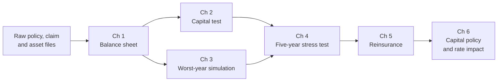

# Enough for the Worst Year

### *Hope for the best. Hold capital for the worst.*


A capital adequacy and stress-testing model for a fictional public auto insurer, built in **SAS**, checked in **R** and **Excel**, with an interactive **Shiny** stress lab.

---

## Prologue

Last year was rough at **Northgate Public Auto**, a fictional public insurer that covers every driver in a Prairie province.

A private insurer in trouble can call its shareholders. Northgate has none. It cannot go bankrupt, and if its capital runs short, the bill lands on drivers as higher rates.

So the board has one question for its new risk analyst:

> *"If next year is a disaster, will we still be standing?"*

This project is the answer. It measures the cushion, tries to break it, and writes the policy that keeps it healthy.

---

## Where things stand

| | Result so far |
|---|---|
| Capital available at 31 Dec 2026 | **$12,919,540.20** |
| Data problems found and fixed | 3 |
| Independent checks | R and Excel both match SAS to the cent |

*The board's full answer will appear here as the remaining chapters are completed.*

---

## The story in six chapters

| Chapter | Name | Question | Status |
|---|---|---|---|
| 1 | Meet the Insurer | What does Northgate own, and what does it owe? | ✅ |
| 2 | How Big Is the Cushion? | Does Northgate pass its capital test? | ⏳ |
| 3 | The Worst Year | How much could one bad year cost? | ⏳ |
| 4 | Stress Test | What happens over five bad years? | ⏳ |
| 5 | Pass the Risk On | Is catastrophe reinsurance worth buying? | ⏳ |
| 6 | Build or Release? | How do capital decisions change drivers' rates? | ⏳ |



*Click a chapter below to expand it.*

<details>
<summary><b>Chapter 1: Meet the Insurer</b> ✅ · Northgate has $12.9 million of capital available</summary>

<br>

*On day one, the analyst receives three raw files from Northgate's systems. Before measuring anything, they have to be trusted.*

### The raw files

| File | Contents | Rows received |
|---|---|---|
| `raw_policies.csv` | 40,000 annual policies written in 2025 and 2026, across five territories | 40,100 |
| `raw_claims.csv` | Every claim reported up to the valuation date | 4,003 |
| `raw_assets.csv` | 25 bonds, 3 equity funds and cash | 29 |

### Three problems, found and fixed

| Check | Records |
|---|---|
| Duplicate policy records removed | 100 |
| Duplicate claim records removed | 298 |
| Claims with no matching policy (set aside for follow-up) | 10 |
| **Clean policies** | **40,000** |
| **Clean claims** | **3,695** |

The duplicate claims were all in one territory. Left uncorrected, they would have made the Western territory look far more expensive than it is:

| Territory | Raw claims | Clean claims | Overstated |
|---|---|---|---|
| Capital | 1,664 | 1,664 | 0.0% |
| Eastern | 562 | 562 | 0.0% |
| Northern | 186 | 186 | 0.0% |
| Southern | 718 | 718 | 0.0% |
| **Western** | **863** | **565** | **52.7%** |

Every dollar removed from case reserves is accounted for:

| Line | Amount ($) |
|---|---|
| Case reserves in raw file | 14,863,250.00 |
| Less: duplicate claim records | (816,075.00) |
| Less: claims with no matching policy | (50,000.00) |
| **Case reserves after cleaning** | **13,997,175.00** |

### The maths

**Unearned premium** is the premium for cover still to come, on policies in force at the valuation date:

$$\text{UPR} = \sum_{\text{in-force } i} P_i \times \frac{\text{days of cover left}_i}{365}$$

**Unpaid claims** are case reserves on reported claims, plus a provision for claims incurred but not yet reported (IBNR), set at an illustrative 15% of case reserves:

$$\text{Unpaid claims} = \text{Case reserves} \times (1 + 0.15)$$

**Capital available** is what is left once every obligation is covered:

$$\text{Capital Available} = \text{Assets} - \text{UPR} - \text{Unpaid claims}$$

### Northgate's balance sheet at 31 December 2026

| Section | Item | Amount ($) |
|---|---|---|
| Assets | Bonds | 35,344,424.82 |
| Assets | Equities | 6,000,000.00 |
| Assets | Cash | 1,500,000.00 |
| Assets | **Total assets** | **42,844,424.82** |
| Liabilities | Unearned premium | 13,828,133.37 |
| Liabilities | Unpaid claims: case reserves | 13,997,175.00 |
| Liabilities | Unpaid claims: IBNR provision | 2,099,576.25 |
| Liabilities | **Total liabilities** | **29,924,884.62** |
| Capital | **Capital available** | **12,919,540.20** |

**Northgate has about $12.9 million of capital.** Chapter 2 asks whether that is enough.

</details>

<details>
<summary><b>Chapter 2: How Big Is the Cushion?</b> ⏳ · coming soon</summary>

<br>

A simplified Minimum Capital Test (MCT):

$$\text{MCT ratio} = \frac{\text{Capital Available}}{\text{Capital Required}}$$

Capital required will be built from insurance, market, credit and operational risk, less a credit for diversification.

</details>

<details>
<summary><b>Chapters 3 to 6</b> ⏳ · coming soon</summary>

<br>

- **Chapter 3, The Worst Year:** simulate thousands of possible next years and measure the capital hit with Value at Risk and Tail Value at Risk
- **Chapter 4, Stress Test:** five-year projections under a hailstorm, falling interest rates, claim inflation and a market crash
- **Chapter 5, Pass the Risk On:** how much capital catastrophe reinsurance frees up, and whether it is worth the cost
- **Chapter 6, Build or Release?:** a capital target range and what it means for drivers' rates

</details>

---

## How correctness is checked

Every result is built in **SAS**, then rebuilt independently in **R** and in **Excel**, and all three must agree to the cent. **Hand-worked tests** check the logic on examples small enough to verify with a calculator.

| Chapter | R vs SAS | Excel vs SAS | Hand-worked tests |
|---|---|---|---|
| 1 | 9 of 9 lines match | 9 of 9 lines match | 19 passing |

<details>
<summary><b>How to run it</b></summary>

<br>

**SAS** (SAS OnDemand for Academics, free for students):

1. Create a folder `capital-adequacy-stress-testing` in your SAS Studio home, with subfolders `sas`, `data` and `output`
2. Upload the files from `sas/`
3. Run `01_make_raw_files.sas`, then `02_clean_and_build.sas`

**R checks** (from the project folder in RStudio, after copying the CSVs from SAS into `data/`):

```r
source("r/ch01_balance_sheet.R")
testthat::test_file("tests/test_ch01.R")
```

**Excel:** open `excel/ch01_balance_sheet_check.xlsx` and check the Balance Sheet tab.

</details>

<details>
<summary><b>Repository structure</b></summary>

<br>

```
capital-adequacy-stress-testing/
├── sas/       SAS programs: setup, raw data, cleaning and balance sheet
├── r/         R cross-checks
├── tests/     hand-worked tests (testthat)
├── data/      raw CSVs and SAS outputs used by R and Excel
├── excel/     independent Excel rebuild
├── output/    ODS PDF capital report (coming)
├── app/       Shiny stress lab (coming)
└── docs/      screenshots
```

</details>

---

## Important note

**Northgate Public Auto is fictional.** All data is simulated, and all risk factors and assumptions are illustrative and **not calibrated** to any real insurer or to regulatory guidance. The capital test follows the general structure of the MCT, simplified for learning and demonstration. This project is not affiliated with any insurer or regulator.

---

## Author

**Pratham Sood**, Actuarial Mathematics and Statistics, University of Manitoba
[GitHub](https://github.com/soodpratham10) · Also see [The Odds of a Lifetime](https://github.com/soodpratham10/odds-of-a-lifetime)