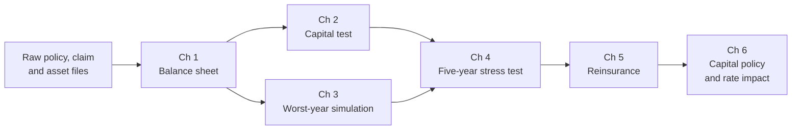

# Enough for the Worst Year

### *Hope for the best. Hold capital for the worst.*


A capital adequacy and stress-testing model for a fictional public auto insurer, built in **SAS**, checked in **R** and **Excel**, with an interactive **Shiny** stress lab.

---

## Prologue

Last year was rough at **Northgate Public Auto**, a fictional public insurer that covers every driver in a Prairie province.

A private insurer in trouble can call its shareholders. Northgate has none. It cannot go bankrupt, and if its capital runs short, the bill lands on drivers as higher rates.

So the board has one question for its new risk analyst:

> *"If next year is a disaster, will we still be standing?"*

This project is the answer. It measures the cushion, tries to break it, and writes the policy that keeps it healthy.

---

## The story in six chapters

| Chapter | Name | Question | Status |
|---|---|---|---|
| 1 | Meet the Insurer | What does Northgate own, and what does it owe? | 🚧 |
| 2 | How Big Is the Cushion? | Does Northgate pass its capital test? | ⏳ |
| 3 | The Worst Year | How much could one bad year cost? | ⏳ |
| 4 | Stress Test | What happens over five bad years? | ⏳ |
| 5 | Pass the Risk On | Is catastrophe reinsurance worth buying? | ⏳ |
| 6 | Build or Release? | How do capital decisions change drivers' rates? | ⏳ |

🚧 in progress · ⏳ planned · ✅ done

---

## The pipeline



---

## The maths at a glance

**Capital test.** Northgate's health is measured by a simplified Minimum Capital Test (MCT) ratio:

$$\text{MCT ratio} = \frac{\text{Capital Available}}{\text{Capital Required}}$$

Capital required is built from insurance, market, credit and operational risk, less a credit for diversification between insurance and market risk.

**The worst year.** Next year's capital loss $L$ is simulated thousands of times. The worst cases are measured with Value at Risk and Tail Value at Risk at security level $p$:

$$\text{VaR}_p(L) = F_L^{-1}(p)$$

$$\text{TVaR}_p(L) = E\left[L \mid L > \text{VaR}_p(L)\right]$$

More maths, results and charts will be added chapter by chapter.

---

## How correctness is checked

Every result is checked three ways:

1. **Hand-worked tests** with expected values calculated independently
2. **R** rebuilds key calculations and must match SAS
3. **Excel** rebuilds the capital test and projections in spreadsheet formulas and must match SAS

---

## Repository structure

```
capital-adequacy-stress-testing/
├── sas/       SAS programs, one per chapter, plus run_all.sas
├── r/         R cross-checks
├── tests/     hand-checked expected values
├── data/      small CSV exports used by R and Excel
├── excel/     independent Excel rebuild
├── output/    ODS PDF capital report
├── app/       Shiny stress lab
└── docs/      screenshots
```

---

## Important note

**Northgate Public Auto is fictional.** All data is simulated, and all risk factors and assumptions are illustrative and **not calibrated** to any real insurer or to regulatory guidance. The capital test follows the general structure of the MCT, simplified for learning and demonstration. This project is not affiliated with any insurer or regulator.

---

## Author

**Pratham Sood**, Actuarial Mathematics and Statistics, University of Manitoba
[GitHub](https://github.com/soodpratham10) · Also see [The Odds of a Lifetime](https://github.com/soodpratham10/odds-of-a-lifetime)